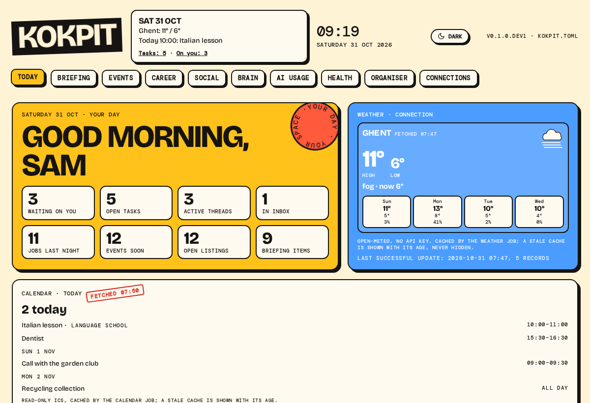
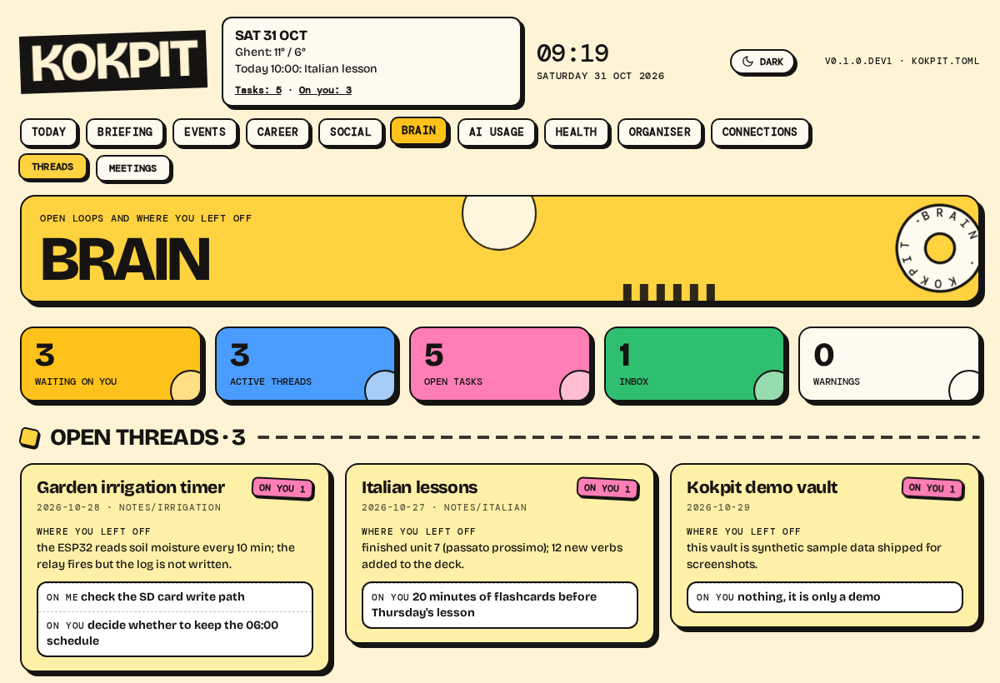
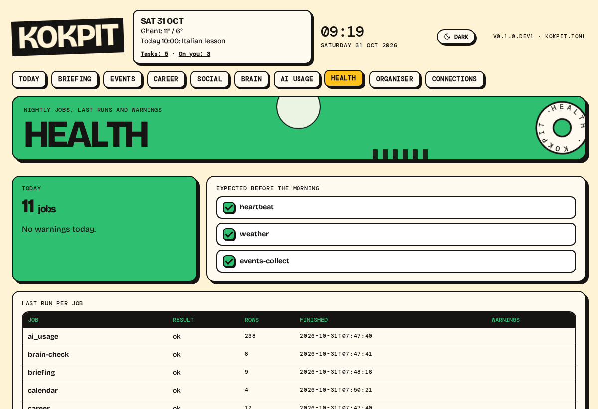

<p align="center">
  
</p>

<h1 align="center">Kokpit</h1>

<p align="center">
  A self-hosted personal dashboard that several AI agents share as one brain.<br>
  Calendar, notes, news, events, jobs and AI usage on one page, on your own device.
</p>

<p align="center">
  <a href="#quick-start">Quick start</a> ·
  <a href="#features">Features</a> ·
  <a href="#documentation">Docs</a> ·
  <a href="docs/add-your-city.md">Add your city</a> ·
  <a href="CONTRIBUTING.md">Contributing</a> ·
  <a href="README.tr.md">Türkçe</a>
</p>

<p align="center">
  
  
  
  
  <a href="https://github.com/sahindemirbas/kokpit/actions/workflows/tests.yml"></a>
</p>

What makes it different:

- One shared brain. Hermes, Claude Code, Codex or Antigravity work in the same Markdown vault, read the last session and open threads, and leave a session card and a receipt, so the next agent picks up where the last one left off.
- No AI key needed. Every module has a rule-based path; a model is opt-in. AI usage tracking is honest: a cost or quota that cannot be determined is shown as unknown, never counted as zero.
- Standard library only. `dependencies = []`, no build step, runs on a Raspberry Pi or any small server.
- Private by default. No hosted service, no account; your data stays in local SQLite and plain Markdown files.

<p align="center">
  
</p>

Early, before 1.0: see [docs/status.md](docs/status.md) for what works and what does not yet.

## Features

- Today: calendar, tasks, dates, weather and counts from every other module.
- Briefing: a daily digest from your own feeds, ranked against the open threads in your notes.
- Events in your city, job listings scored with a written reason, and the market behind them.
- Brain: your notes as projects and threads, shared with the AI agents you use.
- AI usage for Hermes, Claude Code and Codex, read from their local logs.
- Health and Connections: when each job last worked and what each source reads.
- English and Turkish screens, a setup screen on first run, Docker if you prefer it.

| | | |
|---|---|---|
|  |  |  |
| Today | Brain | Health |

All screenshots use synthetic demo data.

<details>
<summary>What each module does</summary>

<br>

| Module | What it does |
|---|---|
| Today | Calendar (read-only ICS), open tasks, upcoming dates, decisions waiting on you, live weather from Open-Meteo, counts from the other modules. |
| Briefing | A daily digest from your own RSS/Atom feeds and keywords. Items that match an open thread in your notes are tagged and come first. Optional model summaries, text to speech and a two-voice podcast; a player stays at the bottom of every screen. |
| Events | What is on in your city from AllEvents and Eventbrite plus local adapters, with category rules in your language. |
| Career | Three leaves. Jobs: a local profile, listings scored with a written reason ("Python, SQL; remote not stated"), listing lifecycle, CSV export. Market: listing counts for the last 8 weeks and an optional weekly note. Skills: what listings ask for and your profile lacks, each marked learning, known or skip. Indeed and Jooble are optional sources (Playwright). |
| Brain | Your Markdown notes as projects and open threads, quick capture that only appends, and Meetings, which turns a note's question list into a form. |
| Social | Your own Instagram account through the official API (posts, reels, stories, daily snapshots), a content calendar and publishing that waits for your approval. Analysis and publishing have separate switches, both off by default. |
| AI usage | Reads the local logs of Hermes, Claude Code and Codex (read-only, one switch per reader). Tokens per model and hour, an approximate cost from models.dev list prices, limits you enter yourself, rule-based advice with its evidence. |
| Organiser | An optional night job that proposes tidying steps for your notes (categorise, link, todo). It never edits, moves or deletes a note. |
| Health and Connections | The last successful run of every job, and one screen with every data source, what it reads and when it last worked. |
| Telegram bot | The morning line and a few commands, off by default. |

Planned ([roadmap](docs/roadmap.md)): `pip install kokpit`, `kokpit doctor`, and Google read-only calendar through OAuth (the secret ICS address already works for Google Calendar).

</details>

## Why Kokpit

Kokpit gathers the things you check every morning into one small web page that runs on your own device. It reads only the data you connect and keeps everything in SQLite and plain Markdown.

- One notes folder, many AI agents. Each agent reads the last session and open threads, then records what it changed. `kokpit brain agents init` sets up Claude Code, Codex and Antigravity in one step. See [docs/brain-protocol.md](docs/brain-protocol.md).
- No model required. Collection is plain code and every module has a rule-based path. A model is an opt-in connection for summaries and translation, with an API key in the environment or routed through a local Hermes agent (`[model] provider = "hermes"`).
- Unknown is not zero. A price, quota or measurement that cannot be determined is shown as unknown, never as 0. A source that silently returns nothing shows "0 records", not "OK".
- Your device, your data. Everything is off until enabled. Delete the app and your notes and database are still there.

## How it works

- Standard library only: the server is `http.server`, storage is `sqlite3`, config is `tomllib`.
- Jobs record their own freshness. Every run stores its status and record count, shown on each card and on Health.
- Rule-based scoring. Career listings and Briefing items get a score and a reason you can read and argue with.
- Privacy. Session ids are stored only as a short sha256 prefix; message text is never read into the database. More in [docs/privacy.md](docs/privacy.md).
- Tests on CI. GitHub Actions runs the unit tests on Python 3.11, 3.12 and 3.13.

More in [docs/architecture.md](docs/architecture.md).

## Quick start

Python 3.11 or newer. Nothing else to install.

```bash
git clone https://github.com/sahindemirbas/kokpit
cd kokpit
./run        # creates kokpit.toml and a starter vault, serves http://127.0.0.1:8501
```

A browser tab opens on the setup screen. Answer seven short questions (language, name, city, news topics, CV, model, summary) or skip any of them, then press Finish. If no tab opens, use the address printed in the terminal. Every answer can be changed later from Connections > Setup or in `kokpit.toml`. Keys you type go to a `.env` file next to `kokpit.toml`, never into it.

The screens are in English or Turkish; the language you pick applies everywhere, and another language is one file (see [docs/modules.md](docs/modules.md#languages)). To answer the same questions in the terminal, run `python -m kokpit init` before the first `./run`.

### Docker

```bash
docker compose up -d      # dashboard on http://127.0.0.1:8501 plus a scheduler for the enabled modules
```

Data lives in the `kokpit-data` volume. The port is bound to loopback because Kokpit has no login. Telegram bot, LAN access, backup: [docs/docker.md](docs/docker.md).

<details>
<summary><b>More commands and settings</b></summary>

<br>

| Command | What it does |
|---|---|
| `python -m kokpit place "Ghent"` | list candidates from the Open-Meteo geocoder; add `--pick 1 --write` to save one |
| `python -m kokpit jobs` | list the jobs and whether each is on |
| `python -m kokpit run-job <name>` | run one job now (`weather`, `calendar`, `events-collect`, `career`, ...) |
| `python -m kokpit schedule` | foreground loop that runs the enabled jobs on time |
| `python -m kokpit adapters` | list local event adapters and whether they are on |
| `python -m kokpit career --help` | career profile, CV import and listings |
| `python -m kokpit ai-usage summary` | AI usage totals for today, 7 and 30 days |
| `python -m kokpit context` | print the brain context an agent hook would receive |
| `python -m kokpit bot send-test` | send one test message to the configured Telegram chat |
| `python -m kokpit hermes status` / `hermes setup` | what is connected to Hermes and the fix for each missing piece / connect it step by step (y/N per step, `--dry-run`) |
| `python -m kokpit instagram setup` / `instagram check` | connect Instagram: the Meta steps with links, a hidden token prompt, one read-only check / check the stored token |
| `python -m unittest discover -s tests` | run the tests |

- Notes: set `vault_path` in `kokpit.toml` to your Markdown folder.
- Calendar: add ICS addresses to `calendar_ics_urls` (or `KOKPIT_CALENDAR_ICS_URLS`). Treat an ICS address like a password.
- Optional modules: switch them on in `kokpit.toml` (`events`, `briefing`, `bot` and the others) or from Connections. Event page slugs are only written with `--confirm-slug`, after you have checked them on the site.
- Demo data: the GIF and screenshots use the synthetic vault in [docs/demo-vault/](docs/demo-vault/), the city set to Ghent, Belgium, and generated sample rows for the other tabs:
  `python -m kokpit init --vault <copy> --db /tmp/demo.db --city "Ghent, Belgium" --name Sam --language en --yes`

</details>

### Connect Hermes

Run `python -m kokpit hermes setup`. It sends model calls through Hermes (no API key in Kokpit), switches on the Hermes usage reader and links the brain plugin, asking before each step. `python -m kokpit hermes status` shows what is still missing and how to fix it. Details: [docs/connections.md#hermes-off-by-default](docs/connections.md#hermes-off-by-default).

### Connect Instagram

Run `python -m kokpit instagram setup`, or open the Social tab. Both show the Meta app steps with links, take the token, check it with one read-only call and switch the analysis on. Details and a troubleshooting table: [docs/connections.md#instagram-analysis-off-by-default](docs/connections.md#instagram-analysis-off-by-default).

## Add your city

Generic sources work for any city once you type its name. Local sources (theatres, town halls, tourism offices) are small adapters under `adapters/events/<city>/`; copying the template and pointing it at your own town is the easiest way to contribute. Event categories can be matched in your language through a JSON keyword pack.

Guides: [add-your-city.md](docs/add-your-city.md) · [adapter contract](adapters/README.md) · [category-packs.md](docs/category-packs.md)

## Documentation

| | |
|---|---|
| [Architecture](docs/architecture.md) | runtime, data flow, storage |
| [Modules](docs/modules.md) | every module: purpose, inputs, status |
| [Brain protocol](docs/brain-protocol.md) | one vault shared by several AI agents |
| [Connections](docs/connections.md) | permissions and secret handling |
| [Privacy](docs/privacy.md) | what never leaves your device |
| [Docker](docs/docker.md) | container setup, bot, backup |
| [Status](docs/status.md) · [Roadmap](docs/roadmap.md) | what exists, what is next |
| [Hermes integration](integrations/hermes/README.md) | optional, not required |
| [Contributing](CONTRIBUTING.md) | run it locally, tests, adding a city, pull requests |

## Who it is for

People who have a device that stays on and do not mind editing a config file now and then. It is not a hosted service, a phone app or a team workspace; each person runs their own instance.

Kokpit is a personal project, built and used by its author. Issues and pull requests are welcome (see [CONTRIBUTING.md](CONTRIBUTING.md)), but there is no support and no response-time guarantee. Breaking changes are possible before 1.0.

## Licence and credits

MIT, see [LICENSE](LICENSE). The package uses only the Python standard library.

The second-brain conventions build on [Avenox Beyin](https://github.com/avenoxai/avenoxbeyin) (MIT, © Avenox), run here as a modified local fork. No Beyin code is copied into this repository; details in [THIRD_PARTY_NOTICES.md](THIRD_PARTY_NOTICES.md) and [docs/brain-protocol.md](docs/brain-protocol.md) §0.

Built by [Sahin Demirbas](https://github.com/sahindemirbas), a data professional based in Italy, for his own mornings first.
