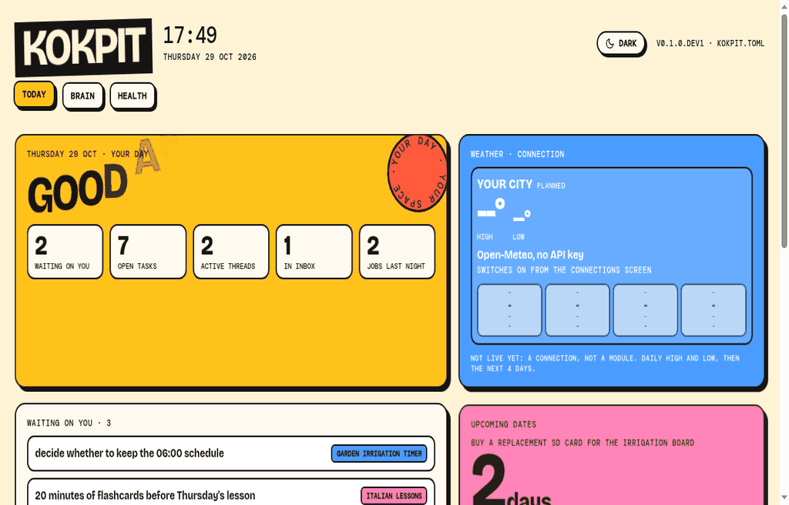

# Kokpit

A self-hosted personal cockpit: one small web dashboard that gathers the things you check every morning, runs on your own device, and reads only the data you connect to it. A short Telegram message tells you in the morning whether anything needs you.

**Status: M1 skeleton.** This repository contains the product design, module specifications, privacy model and roadmap, plus a runnable skeleton (`./run`: Today, Events, Brain, Health and Connections tabs over a starter vault; no package on PyPI yet). The design is extracted from a working single-user instance that has run daily on a Raspberry Pi since 2025; see [docs/status.md](docs/status.md) for what exists today, what still has to be generalised, and what is only planned.

Turkish version: [README.tr.md](README.tr.md)



The recording and the screenshots in `docs/media/` come from the synthetic sample vault in `docs/demo-vault/` (an irrigation timer, Italian lessons; nothing real) with the city set to Lodi, Italy. They show the five M1 tabs and live Open-Meteo weather. To reproduce: copy `docs/demo-vault/` somewhere, `python -m kokpit init --vault <copy> --db /tmp/demo.db --city "Lodi, Italy"`, set `events = true` and `expected = ["heartbeat", "brain-check", "weather", "events-collect"]` in `kokpit.toml`, run the four jobs, then `./run`.

## A typical day

This is how the reference instance is used today. Names and numbers below are illustrative.

- 07:30: one Telegram line arrives: "2 decisions waiting on you, 1 job failed overnight, 3 new listings match your targets." If nothing is wrong, the line says so and stops there.
- You open the dashboard. The Today tab shows the calendar, tasks due this week, the two decisions people are waiting for, and the weather for your city and the one you commute to.
- The Brain tab shows where each project was left, split into "on you / on me / on someone else". You type a quick note; it is appended to your inbox file, nothing else is touched.
- You ask an AI agent (any of Hermes, Claude Code, Codex, Antigravity) to continue a task. It reads the same notes folder, sees the last session card and the open threads, and at the end writes a new session card and a receipt. The next agent, or you, picks up from there.
- Events shows a free concert at the opera house tonight and a food fair in a neighbouring town on Saturday, each with a calendar file.
- Career shows new listings with a written reason for each match ("Python, SQL; Milan; remote not stated"), never a bare percentage.
- The AI usage tab shows what the agents consumed today, the subscription limits where the provider exposes them, and marks any price it cannot determine as unknown.

## What it is for

You open one page in the morning and see:

- **Today**: calendar, open tasks, upcoming dates, decisions people are waiting on from you, weather for the places you care about.
- **Second brain**: your own local Markdown notes (projects, open threads, "where did I leave this"), with quick capture of notes and tasks. Notes stay plain files that Obsidian or any editor can open.
- **Career**: a skills/experience/language profile extracted from your CV and corrected by you, plus your target roles, locations and remote preferences; job listings found and matched with a written reason, not just a percentage.
- **Events**: what is happening in your city and nearby, with category and free/paid filters, list, calendar and map views, and a per-event calendar file.
- **Social media**: statistics for your own accounts, content comparison and calendar, drafts and reminders. Publishing only on supported platforms and only after explicit approval.
- **AI usage**: per tool, model and session; limits and reset times where the provider exposes them; data freshness shown. Real API spend, subscription fees and list-price equivalents are kept apart.
- **Agenda**: a daily digest of news in the areas you follow, optionally as a short audio summary. Items that relate to one of your active projects are tagged with the project and a stated reason.
- **System health**: last successful update per connection, failed jobs, broken links. A connection that silently returns nothing is shown as "last update: 0 records", not as healthy.
- **Telegram bot** (optional): the morning line, reminders, and approval buttons for anything that publishes or spends.

Everything is a module. You enable what you want from a Connections screen; nothing else runs.

## What makes it different

**One notes folder, many agents.** The second brain is a plain Markdown folder you own. Several AI tools can work in it under one contract: a read-only hook gives every agent the open threads and the last session; at the end of a session the agent writes a `Last-Session.md` card, updates `Threads.md` and leaves a receipt saying what it changed. You can switch tools mid-project without losing the thread, and you can audit what each agent did. The conventions come from [Avenox Beyin](https://github.com/avenoxai/avenoxbeyin) (MIT), run here as a modified local fork; the full contract is in [docs/brain-protocol.md](docs/brain-protocol.md).

**Works without an AI key.** Collection is plain code: scheduled fetchers pull known sources (job boards, event pages, RSS, official APIs), parse them and store rows; no model is involved in gathering data. On top of that each module has a rule-based path: keyword scoring for jobs, keyword rules for event categories, rule-based usage advice, a template morning report. A model is an opt-in connection that adds summaries, translation and richer matching; it is never a requirement to run a module. Where that rule path is still missing today is marked in [docs/status.md](docs/status.md).

**Honest about what it does not know.** Unknown prices, unexposed quotas and failed measurements are shown as unknown. Empty results are visible. Features are labelled working, needs generalisation, or planned.

**Nothing to leave behind.** Data lives in SQLite and Markdown on your device. Delete the app and you still have your notes, your exports and your database.

## Principles

1. **Your device, your data.** Kokpit runs locally (a Raspberry Pi, a home server, a laptop). Nothing is sent to a hosted service of ours; there is none.
2. **Every connection is visible.** For each enabled connection you can see what data is read, which permission was granted, and when it last succeeded.
3. **Analysis and publishing are separate permissions.** Reading your Instagram statistics never implies the right to post.
4. **No silent AI calls.** If a module sends data to an external model, the data and the destination are stated and approved first. CV matching does not need your name, phone or e-mail.
5. **Unknown is not zero.** A price we cannot determine, a quota a provider does not expose, a measurement that failed: these are shown as unknown, never as 0.
6. **Honest labels.** Features are marked as working, needs generalisation, or planned. The docs never describe a command that does not exist as if it did.
7. **No model required.** Every module has a rule-based baseline that runs without a model; a model is an opt-in connection that improves it, listed and approved like any other. Which baselines exist today is tracked in [docs/status.md](docs/status.md).

## What you need, and who this is not for

Target requirements once the first release exists:

- A device that stays on (Raspberry Pi, home server, old laptop) with Python 3.
- A folder of Markdown notes, or the empty starter structure shipped with the app.
- Optional: a Telegram bot token for the morning line; a Meta developer app for Instagram statistics; a model API key for summaries and translation.
- Some willingness to edit a configuration file; the first release is for people who are comfortable with that.

Not for you if you want a hosted service, a phone app, cloud sync between devices, or a team workspace. Each person runs their own instance; those are out of scope for the first release.

## Add your city

Generic sources (AllEvents, Eventbrite, Open-Meteo) work for any city once you enter its name. Local sources such as theatres, municipalities and tourism offices have no city parameter, so they live as small adapters under `adapters/events/<city>/` with a documented JSON contract. The author's Cremona adapters will ship as examples, disabled by default. Copying one and pointing it at your own town's agenda is the intended way to contribute; the step-by-step is in [docs/add-your-city.md](docs/add-your-city.md), the record contract in [adapters/README.md](adapters/README.md). The same contract applies to job sources under `adapters/jobs/`.

## Repository layout

```
README.md               this file
README.tr.md            Turkish version
docs/
  architecture.md       runtime shape, data flow, storage
  modules.md            every module: purpose, inputs, connections, status
  brain-protocol.md     one vault shared by several AI agents; night organiser; brain-driven agenda
  connections.md        the Connections screen, permissions, secrets handling
  privacy.md            what never enters this repo or leaves your device
  status.md             working / needs generalisation / planned
  roadmap.md            milestones and the pre-public checklist
  add-your-city.md      generic sources today, local adapter contract for M2
adapters/
  README.md             JSON contract for community data adapters (events, jobs)
integrations/
  hermes/README.md      optional integration with the Hermes agent (not required)
config/
  kokpit.example.toml   example configuration, no personal data (full target shape)
kokpit/                 the package: config, db, jobs, web, static/index.html
  modules/today|brain|health
run                     one-command start
tests/                  unit tests on synthetic fixtures + one end-to-end test
```

## Try it (M1 skeleton)

Python 3.11 or newer, nothing else to install:

```
git clone https://github.com/sahindemirbas/kokpit
cd kokpit
./run                     # writes kokpit.toml + a starter vault in data/, serves http://127.0.0.1:8501
```

What you get today: the Today, Events, Brain, Health and Connections tabs over a starter vault, a weather card (Open-Meteo, filled by the `weather` job), an events list for your city (AllEvents and Eventbrite, filled by `events-collect` once `events` is switched on in `kokpit.toml`) and a health table filled by the jobs (`heartbeat`, `brain-check`, `weather`, `events-collect`, `calendar`). The calendar card on Today connects read-only to one or more ICS addresses set in `calendar_ics_urls` (or the `KOKPIT_CALENDAR_ICS_URLS` environment variable, space-separated); the `calendar` job caches today plus the next 6 days. Treat an ICS address like a password: keep it only in your local `kokpit.toml` or in the environment variable. Point `vault_path` in `kokpit.toml` at your own Markdown folder to see your threads and tasks; quick capture appends to `inbox/` or `To-Do.md` and never rewrites a note. To set your city: `python -m kokpit place "Bergamo"` lists candidates (Open-Meteo geocoder, no key), `--pick 1` prints the `[place]` and `[events]` block with the event sources known for that country, `--write` updates `kokpit.toml` (a `.bak` copy is kept), and the derived AllEvents/Eventbrite slugs are written only with `--confirm-slug`, after you have opened them on the site. Other commands: `python -m kokpit jobs`, `python -m kokpit run-job <name>`. Tests: `python -m unittest discover -s tests`.

Local event adapters, career, social, AI usage, agenda and the bot are not in the skeleton yet (see `docs/roadmap.md`). The eventual `pip install kokpit` and Docker paths are planned, not available.

## Licence

MIT, see [LICENSE](LICENSE). The package depends only on the Python standard library. The second-brain conventions come from Avenox Beyin (MIT, copyright Avenox); no Beyin code is copied into this repository today, and any file derived from it later carries the original notice. Details in [THIRD_PARTY_NOTICES.md](THIRD_PARTY_NOTICES.md). The repository is still private; the licence choice does not change that.

## Author

The second-brain conventions build on [Avenox Beyin](https://github.com/avenoxai/avenoxbeyin) (MIT), run here as a modified local fork; see `docs/brain-protocol.md`, section 0.

Built by [Sahin Demirbas](https://github.com/sahindemirbas), a data professional based in Italy, for his own daily use first.
