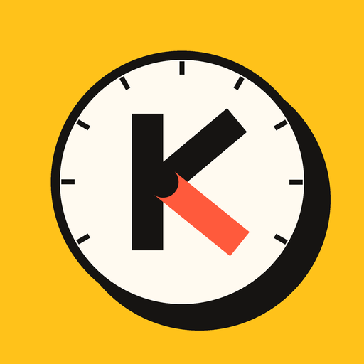

<p align="center">
  
</p>

<h1 align="center">Kokpit</h1>

<p align="center">
  <b>Sabahın tek sayfada.</b><br>
  Raspberry Pi ya da herhangi küçük bir sunucuda çalışan, kendi kendine barındırılan kişisel panel. AI anahtarı gerekmez.
</p>

<p align="center">
  <a href="#hızlı-başlangıç">Hızlı başlangıç</a> •
  <a href="docs/status.md">Durum</a> •
  <a href="docs/roadmap.md">Yol haritası</a> •
  <a href="docs/add-your-city.md">Şehrini ekle</a> •
  <a href="README.md">English</a>
</p>

<p align="center">
  
  
  
  
  <a href="https://github.com/sahindemirbas/kokpit/actions/workflows/tests.yml"></a>
</p>

<p align="center">
  
</p>

Kokpit her sabah baktığın şeyleri (takvim, görevler, notların, şehrindeki etkinlikler, iş ilanları, kendi betiklerinin sağlığı) kendi cihazında çalışan tek bir küçük web sayfasında toplar. Yalnız senin bağladığın verileri okur, her şeyi SQLite ve düz Markdown dosyalarında tutar.

> **Durum:** erken aşama. M1-M3 kilometre taşları tamam; M4'ten AI kullanımı sekmesi ve Instagram analizi de tamam; aşağıdaki panel bugün `./run` ile çalışıyor. Sosyal medyada paylaşım, günlük gündem, ve Telegram botu planlı; `docker compose up` çalışıyor (aşağıda Docker'a bak). Tasarım, 2025'ten beri her gün küçük bir ev sunucusunda çalışan tek kullanıcılı bir kurulumdan çıkarıldı. Ayrıntı: [docs/status.md](docs/status.md).

## Özellikler

**Bugün çalışan**

- **Today:** takvim (salt okunur ICS), açık görevler, yaklaşan tarihler, Open-Meteo'dan canlı hava.
- **Brain:** Markdown notların projeler ve açık işler olarak; hızlı not yalnız ekleme yapar, hiçbir notu yeniden yazmaz.
- **Events:** AllEvents ve Eventbrite'tan şehrindeki etkinlikler; yerel adaptörler ve kendi dilinde kategori kuralları.
- **Career:** yerel profil, yazılı gerekçeyle puanlanan ilanlar ("Python, SQL; Milano; uzaktan belirtilmemiş"), ilan yaşam döngüsü, pazar görünümü, CSV dışa aktarım.
- **Health:** her işin son başarılı çalışması. Sessizce boş dönen bir kaynak "0 kayıt" olarak görünür, "OK" olarak değil.
- **Connections:** her veri kaynağı tek ekranda: ne okuyor, en son ne zaman çalıştı. Sen açana kadar hepsi kapalı.
- **Social:** kendi Instagram hesabın, gönderilerin, reels ve hikayeler, metrikleriyle birlikte resmi API üzerinden okunur ve günlük anlık görüntü olarak saklanır. Salt okunur, varsayılan olarak kapalı.
- **AI usage:** Hermes, Claude Code ve Codex'in yerel kayıtlarını salt okunur okur (her okuyucu ayrı bir anahtar). Model ve saat bazında token, models.dev liste fiyatlarından yaklaşık maliyet, kanıtıyla birlikte kural tabanlı öneriler. Fiyatı bilinmeyen model 0 değil "bilinmiyor" görünür. Kendi girdiğin isteğe bağlı token limitleri. Tek ağ isteği, isteğe bağlı fiyat yenilemesidir.

**Planlanan** ([yol haritası](docs/roadmap.md))

- Onaylı Instagram paylaşımı, içerik takvimi
- Projelerine bağlanan günlük haber özeti, isteğe bağlı sesli
- Sabah satırı ve onay düğmeleriyle Telegram botu
- `pip install kokpit`

## Neden Kokpit

- **Tek not klasörü, çok AI ajanı.** Hermes, Claude Code, Codex ya da Antigravity aynı Markdown vault'unda çalışabilir. Her biri son oturumu ve açık işleri okur, bitince bir oturum kartı ve neyi değiştirdiğini söyleyen bir makbuz bırakır. Proje ortasında araç değiştirebilir, her adımı denetleyebilirsin. Bkz. [docs/brain-protocol.md](docs/brain-protocol.md).
- **Model şart değil.** Veri toplama düz koddur ve her modülün kural tabanlı bir yolu vardır. Model; özet ve çeviri ekleyen, isteğe bağlı bir bağlantıdır.
- **Bilinmeyen sıfır değildir.** Belirlenemeyen fiyat, kota ya da ölçüm "bilinmiyor" diye görünür, asla 0 diye değil. Özellikler çalışıyor, genelleştirilecek ya da planlanan diye etiketlenir.
- **Senin cihazın, senin verin.** Barındırılan bir servis yok. Uygulamayı silsen de notların ve veritabanın yerinde kalır.

## Nasıl çalışır

- **Yalnız standart kütüphane.** `pyproject.toml` içinde `dependencies = []`; sunucu `http.server`, depolama `sqlite3`, ayarlar `tomllib`.
- **SQLite deposu.** Tek yerel veritabanı dosyası ve düz Markdown notlar. Barındırılan servis yok.
- **İşler tazeliğini kendisi kaydeder.** Veri toplama düz Python'dır. Her çalışma durumunu ve kayıt sayısını saklar; boş dönen kaynak "OK" değil "0 kayıt" görünür.
- **Kariyer puanlaması kural tabanlıdır.** Her ilan, okuyup tartışabileceğin yazılı bir gerekçeyle puan alır.
- **AI usage okuyucuları tekrarı eler.** Birkaç kayıt satırında geçen tek bir API mesajı bir kez sayılır. Bilinmeyen fiyat bilinmeyen kalır.
- **Varsayılan olarak gizlilik.** Her şey yerel ve sen açana kadar kapalı. Oturum kimlikleri yalnız kısa bir sha256 öneki olarak saklanır, mesaj metni veritabanına okunmaz.
- **Testler CI'da çalışır.** GitHub Actions birim testlerini Python 3.11, 3.12 ve 3.13 ile çalıştırır.

Daha fazlası için [docs/architecture.md](docs/architecture.md) (İngilizce).

## Hızlı başlangıç

Python 3.11 ve üstü. Başka kurulum yok.

```bash
git clone https://github.com/sahindemirbas/kokpit
cd kokpit
./run        # kokpit.toml ve başlangıç vault'unu oluşturur, http://127.0.0.1:8501
```

Şehrini ayarla ve Kokpit'i kendi notlarına yönelt:

```bash
python -m kokpit place "Bergamo"            # Open-Meteo geocoder'dan adayları listeler
python -m kokpit place "Bergamo" --pick 1 --write
```

Sonra `kokpit.toml` içindeki `vault_path` değerini kendi Markdown klasörüne çevir.

### Docker

```bash
docker compose up -d      # panel http://127.0.0.1:8501 adresinde, açık modüller için bir zamanlayıcıyla birlikte
```

Veri `kokpit-data` volume'unda durur. Kokpit'te giriş yok; bu yüzden port yalnızca loopback'e bağlı. Telegram botu, LAN erişimi, yedek: [docs/docker.md](docs/docker.md).

<details>
<summary><b>Diğer komutlar ve ayarlar</b></summary>

<br>

| Komut | Ne yapar |
|---|---|
| `python -m kokpit jobs` | zamanlanmış işleri listeler |
| `python -m kokpit run-job <ad>` | bir işi hemen çalıştırır (`weather`, `events-collect`, `calendar`, ...) |
| `python -m kokpit adapters` | yerel etkinlik adaptörlerini ve açık olup olmadıklarını listeler |
| `python -m kokpit career` | kariyer profili ve puanlama |
| `python -m kokpit context` | bir ajan hook'una verilecek beyin bağlamını yazdırır |
| `python -m unittest discover -s tests` | testleri çalıştırır |

- **Takvim:** `calendar_ics_urls` (ya da `KOKPIT_CALENDAR_ICS_URLS`) içine bir veya daha fazla ICS adresi ekle. ICS adresini parola gibi sakla.
- **Etkinlikler:** `kokpit.toml` içinde `events = true` yap. Etkinlik sayfası slug'ları ancak sitede kontrol ettikten sonra `--confirm-slug` ile yazılır.
- **Demo verisi:** GIF, [docs/demo-vault/](docs/demo-vault/) içindeki sentetik vault ve Lodi, İtalya şehriyle çekildi:
  `python -m kokpit init --vault <kopya> --db /tmp/demo.db --city "Lodi, Italy"`.

</details>

## Şehrini ekle

Genel kaynaklar şehir adını yazınca her şehirde çalışır. Tiyatro, belediye, turizm ofisi gibi yerel kaynaklar `adapters/events/<şehir>/` altında küçük adaptörlerdir. Şablonu kopyalayıp kendi şehrine yöneltmek katkı vermenin en kolay yolu. Etkinlik kategorileri JSON anahtar kelime paketiyle kendi dilinde eşleşebilir.

Rehberler (İngilizce): [add-your-city.md](docs/add-your-city.md) · [adaptör sözleşmesi](adapters/README.md) · [category-packs.md](docs/category-packs.md)

## Dokümanlar

Dokümanlar İngilizce yazılmıştır.

| | |
|---|---|
| [Architecture](docs/architecture.md) | çalışma yapısı, veri akışı, depolama |
| [Modules](docs/modules.md) | her modül: amaç, girdiler, durum |
| [Brain protocol](docs/brain-protocol.md) | birden fazla AI ajanının paylaştığı tek vault |
| [Connections](docs/connections.md) | izinler ve gizli bilgilerin korunması |
| [Privacy](docs/privacy.md) | cihazından asla çıkmayanlar |
| [Status](docs/status.md) · [Roadmap](docs/roadmap.md) | ne var, sırada ne var |
| [Hermes entegrasyonu](integrations/hermes/README.md) | isteğe bağlı, şart değil |

## Kimin için

Sürekli açık bir cihazı olan ve bir yapılandırma dosyasını düzenlemekten çekinmeyenler için. Barındırılan servis, telefon uygulaması ya da ekip çalışma alanı değil; herkes kendi kurulumunu çalıştırır.

## Proje durumu ve destek

Kokpit, yazarı tarafından yapılan ve kullanılan kişisel bir projedir. Issue ve pull request'ler memnuniyetle karşılanır, ancak destek ya da yanıt süresi garantisi yoktur. 1.0 öncesinde uyumsuz değişiklikler olabilir.

## Lisans ve teşekkür

MIT, bkz. [LICENSE](LICENSE). Paket yalnız Python standart kütüphanesini kullanır.

İkinci beyin düzeni [Avenox Beyin](https://github.com/avenoxai/avenoxbeyin) (MIT, © Avenox) üzerine kurulu; burada değiştirilmiş yerel bir çatal olarak çalışıyor. Depoya Beyin kodu kopyalanmadı; ayrıntı [THIRD_PARTY_NOTICES.md](THIRD_PARTY_NOTICES.md) ve [docs/brain-protocol.md](docs/brain-protocol.md) §0 içinde.

[Sahin Demirbas](https://github.com/sahindemirbas) tarafından, İtalya'da yaşayan bir veri profesyonelinin önce kendi sabahları için yapıldı.
